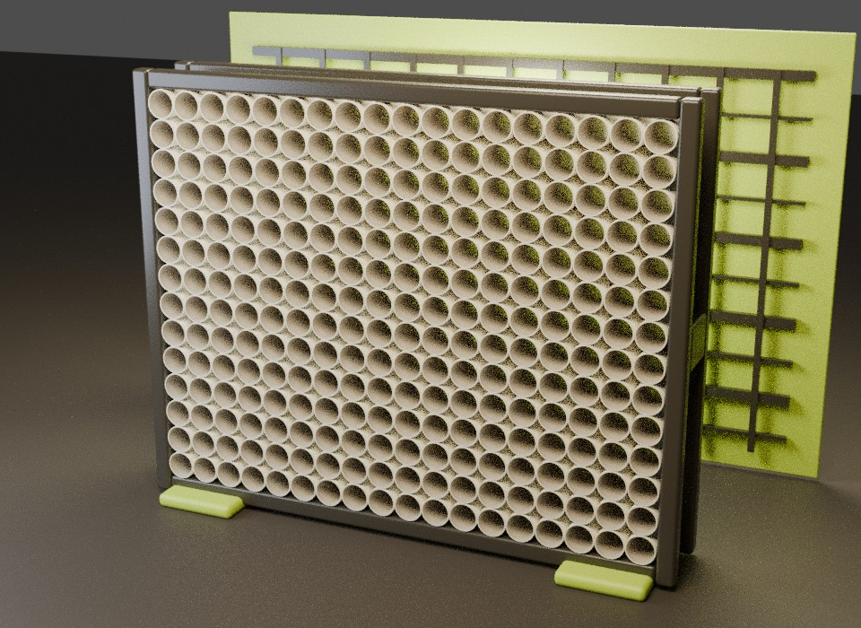
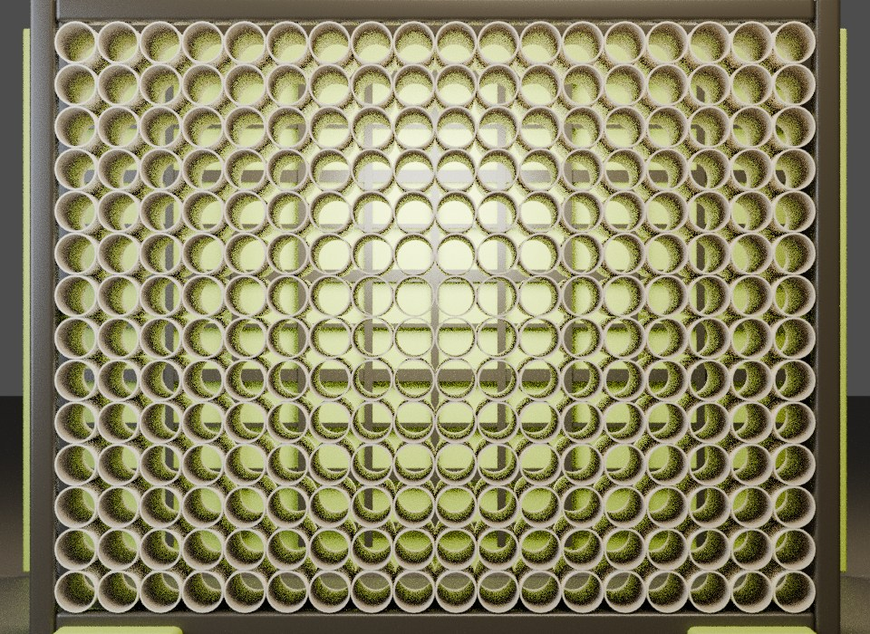
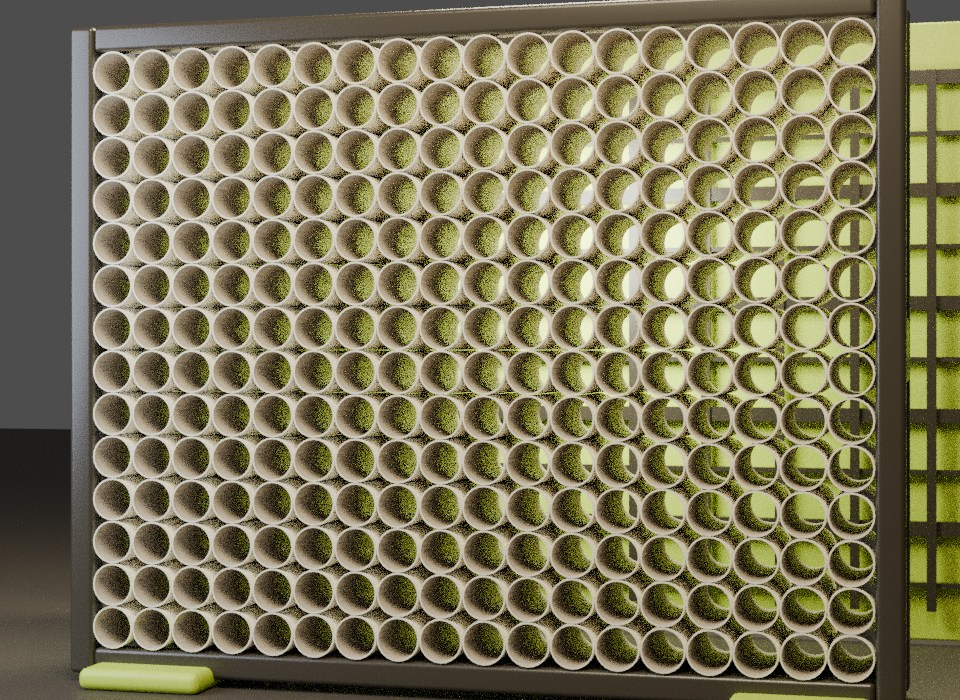

# Optical Channel Array

A parametric Blender study of a parallel-channel optical array inspired by drinking-straw imaging. The model contains **252 annular channels**, not meshes of off-the-shelf drinking straws. The dimensions define a nominal optical study.

## Test geometry

| Parameter | Nominal value |
|---|---:|
| Channels | 18 × 14 |
| Exterior diameter | 8.0 mm |
| Clear bore | 7.4 mm |
| Center pitch | 8.05 mm |
| Channel depth | 25.0 mm |

A straight ray at local incidence angle θ shifts laterally by L tan θ over a channel of length L. With an ideal opaque wall, direct throughput is the normalized intersection area of the near and far bore circles after that shift. For this geometry the straight-ray cutoff is arctan(7.4/25), approximately **16.5°**. That angle is local to each channel. The rendered perspective view does not darken uniformly. Neither the render nor this calculation is a physical transmission measurement.

| On-axis view | Camera offset about 15° |
|---|---|
|  |  |

## Files

- [Blender scene](Optical-Channel-Array.blend): annular meshes, three camera views, lights, and a synthetic alignment target. No external textures.
- [Scene generator](build_panel.py): editable row count, pitch, depth, and bore near the top. Run `blender --background --factory-startup --python build_panel.py` to regenerate the scene and three PNGs beside the script.
- [Full-size placement template](design/placement-template.svg): print at 100%, verify the 50 mm scale bar. A placement guide, not a drill pattern.
- [Replication protocol](design/replication-protocol.txt): parallel alignment, clamp frame, lighting, and matched camera checks.

Related work: [Michael Farrell and Cliff Haynes’s Straw Camera, catalogued by UCL](https://discovery.ucl.ac.uk/id/eprint/10140210/).
